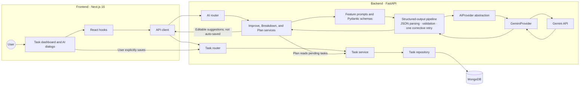

# TaskFlow AI

TaskFlow AI is a local-first task dashboard for small, unstructured workloads. It combines core task and subtask management with optional AI suggestions so people can move from a rough to-do into a clearer plan without losing manual control.

## Features

- **Core to-do management:** Create, edit, complete, filter, sort, and delete tasks and subtasks.
- **Improve writing:** Rewrites a title and description, suggests priority and, only when supported by the text, a due date. Suggestions remain editable and are never auto-saved.
- **Break down:** Suggests three to eight ordered subtasks with descriptions. Suggestions remain editable and are never auto-saved.
- **Plan my day:** Builds a budget-aware plan from pending tasks and marks the remaining work as postponed. The result remains editable and is never auto-saved.

## Architecture



FastAPI requests flow through routers, services, and repositories. Task CRUD stays in `app/api/v1/tasks.py` -> `app/services/task_service.py` -> `app/repositories/task_repository.py` -> MongoDB. AI code is isolated in `app/ai/`; task CRUD does not import or depend on AI services, and AI endpoint failures do not disable CRUD.

## Tech stack

- Frontend: Next.js 16, React 19, TypeScript, Tailwind CSS, Vitest, Testing Library
- Backend: Python 3.11+, FastAPI, Pydantic, PyMongo
- AI: Google Gemini through `google-genai`, provider abstraction, Pydantic-validated structured output
- Data: MongoDB or Atlas for deployment; `mongomock` for unit tests

### Project structure

```text
src/                  Next.js application
  app/                App Router pages and layout
  components/         Task and AI UI components
  hooks/              Task and AI request hooks
  lib/                API client, types, constants, and date helpers
  __tests__/          Vitest tests
backend/
  vercel.json         Vercel Python function duration
  app/
    api/v1/           HTTP health, task, and AI routers
    ai/               Provider abstraction, prompts, schemas, and AI services
    core/             Settings, error handlers, and rate limiting
    db/               MongoDB client and indexes
    repositories/     MongoDB task persistence
    services/         Task domain operations
    schemas/          Task and API Pydantic models
  tests/
    unit/             Offline unit tests
    integration/      Optional real-MongoDB integration test
  requirements.txt    Runtime dependencies
  requirements-dev.txt Runtime plus test/lint dependencies
scripts/
  setup.mjs           Cross-platform one-command setup
public/               Static public assets
```

## Data model

Example task document returned by the API:

```json
{
  "_id": "507f1f77bcf86cd799439011",
  "title": "Prepare project report",
  "description": "Summarize progress and open risks",
  "priority": "high",
  "completed": false,
  "due_date": "2026-11-23",
  "estimated_duration": 90,
  "subtasks": [
    {
      "id": "d3c1a7a8dc5b4f0b8c1c2d3e4f5a6071",
      "title": "Review metrics",
      "description": "Collect the final figures",
      "completed": false,
      "created_at": "2026-11-21T12:00:00Z"
    }
  ],
  "created_at": "2026-11-21T12:00:00Z",
  "updated_at": "2026-11-21T12:00:00Z",
  "completed_at": null
}
```

MongoDB index reasons:

| Index | Reason |
|---|---|
| `idx_tasks_completed_due_date`: `(completed ASC, due_date ASC)` | Supports pending/completed and due-date filtering and ordering. |
| `idx_tasks_priority`: `(priority ASC)` | Supports priority filtering. |
| `idx_tasks_created_at_desc`: `(created_at DESC)` | Supports newest-first task sorting. |

Task schemas enforce title length and trimmed text, priority enums, due dates, duration limits, and bounded subtask lists.

## AI design

`AIProvider` defines the provider boundary; `GeminiProvider` is the current implementation. Prompt files live separately under `backend/app/ai/prompts/` for Improve, Break down, and Plan my day.

The generation pipeline:

1. Provider output is stripped of a JSON code fence when present.
2. Pydantic validates JSON shape and field constraints.
3. Invalid JSON or schema output gets at most one corrective retry.
4. Provider, retry, JSON, and response work is bounded by `AI_TIMEOUT_SECONDS`; provider calls receive the remaining time budget.

Guardrails include prompt-injection-safe delimiters, no invented improve-writing facts or dates, 3-8 deduplicated breakdown steps, exact-plan task IDs from MongoDB, no duplicate planned/postponed task IDs, and a plan total that cannot exceed the requested budget. Plan text rejects claims that tasks are completed or scheduled in a calendar. Improve requires a non-empty description of at least 15 characters after validation and rejects due dates unless the original text contains a date reference.

AI HTTP errors are mapped as:

| Code | HTTP status |
|---|---|
| `ai_not_configured` | 503 |
| `ai_timeout` | 504 |
| `ai_rate_limited` | 429 |
| `ai_invalid_output` | 502 |
| `ai_provider_error` | 502 |

If AI fails, users can keep using task CRUD, enter or edit content manually, and retry the suggestion. AI suggestions are not persisted until the user saves the relevant task/subtask through an existing CRUD action.

## API reference

All task and AI routes are under `/api/v1`; health routes are under `/health`.

| Method | Route | Purpose |
|---|---|---|
| `GET` | `/health` | Application health |
| `GET` | `/health/` | Application health alias |
| `GET` | `/health/db` | MongoDB ping |
| `POST` | `/api/v1/tasks/` | Create task |
| `GET` | `/api/v1/tasks/` | List/filter/sort tasks; supports `status`, `priority`, `q`, `due`, `today`, `sort`, `limit`, `skip` |
| `GET` | `/api/v1/tasks/stats` | Task counts and completion stats |
| `GET` | `/api/v1/tasks/{task_id}` | Get task |
| `PATCH` | `/api/v1/tasks/{task_id}` | Update task fields |
| `DELETE` | `/api/v1/tasks/{task_id}` | Delete task |
| `POST` | `/api/v1/tasks/{task_id}/subtasks` | Add one or more subtasks |
| `PATCH` | `/api/v1/tasks/{task_id}/subtasks/{subtask_id}` | Update subtask |
| `DELETE` | `/api/v1/tasks/{task_id}/subtasks/{subtask_id}` | Delete subtask |
| `POST` | `/api/v1/ai/breakdown` | Suggest 3-8 subtasks |
| `POST` | `/api/v1/ai/improve` | Improve title/description and suggest priority/due date |
| `POST` | `/api/v1/ai/plan` | Generate a daily plan from pending tasks |

## Quick start

Prerequisites:

- Node.js 20+
- Python 3.11+
- MongoDB URI for local MongoDB or MongoDB Atlas
- Gemini API key

From the repository root:

```bash
npm run setup
```

Edit `backend/.env` and set at least `MONGODB_URI` and `GEMINI_API_KEY`. Then run the backend and frontend in separate terminals.

Backend:

```powershell
cd backend
.\.venv\Scripts\Activate.ps1
python -m uvicorn app.main:app --reload --port 8000
```

```bash
cd backend
source .venv/bin/activate
python -m uvicorn app.main:app --reload --port 8000
```

Frontend:

```bash
npm run dev
```

Open <http://localhost:3000>.

## Environment variables

Frontend:

| Name | Purpose | Default |
|---|---|---|
| `NEXT_PUBLIC_API_URL` | FastAPI base URL | `http://127.0.0.1:8000` |

Backend:

| Name | Purpose | Default |
|---|---|---|
| `APP_ENV` | Application environment label | `development` |
| `CORS_ORIGINS` | Allowed origins | `["http://localhost:3000"]` |
| `MONGODB_URI` | MongoDB connection string | empty |
| `MONGODB_DB_NAME` | MongoDB database name | `taskflow` |
| `MONGODB_TIMEOUT_MS` | MongoDB server selection timeout | `5000` |
| `GEMINI_API_KEY` | Gemini API credential | secret; empty by default |
| `GEMINI_MODEL` | Gemini model identifier | `gemini-3.5-flash-lite` |
| `AI_TIMEOUT_SECONDS` | AI generation time budget | `20` |
| `AI_RATE_LIMIT_PER_HOUR` | AI requests per hour per process/client IP | `100` |

`CORS_ORIGINS` uses a JSON-style comma-separated list, for example:

```dotenv
CORS_ORIGINS=["http://localhost:3000","https://taskflow.example.vercel.app"]
```

The backend also accepts comma-separated plain text through its validator, but the JSON list format above is the format used by the example file.

## Testing

Frontend tests:

```bash
npm run test
```

Backend tests:

```bash
cd backend
.\.venv\Scripts\python.exe -m pytest
# macOS/Linux: backend/.venv/bin/python -m pytest
```

Optional real-MongoDB integration test:

```bash
cd backend
.\.venv\Scripts\python.exe -m pytest -m integration
# macOS/Linux: backend/.venv/bin/python -m pytest -m integration
```

The unit suite uses `mongomock` and isolated settings; tests cover task CRUD, filtering, stats, subtasks, health checks, CORS, AI endpoints and errors, Gemini provider behavior, prompt/services, database indexes, and plan validation. The optional integration test is skipped unless `MONGODB_URI` is set. No test makes a real Gemini API call: Gemini requests use provider mocks or an empty-key guard.

Fresh verification: Vitest has 11 test files and 36 tests passing. Backend pytest has 85 unit tests passing, with 1 integration test optionally selected.

## Deployment

### MongoDB Atlas

1. Create an Atlas cluster.
2. Create a database user and store its credentials safely.
3. In **Network Access**, add `0.0.0.0/0` so Vercel serverless functions can reach the cluster. This permits connections from any IPv4 address; use a strong database password and least-privilege database user, and restrict access further if your hosting setup supports stable egress IPs.
4. Copy the Atlas connection string and set it as `MONGODB_URI`.
5. Set `MONGODB_DB_NAME` explicitly for the deployed database.

### Backend API on Vercel

Deploy the backend as a separate Vercel project using the same Git repository:

1. Set **Root Directory** to `backend`.
2. Vercel reads `backend/vercel.json` and exposes `app/main.py` as the FastAPI function with a 60-second maximum duration.
3. Add these backend environment variables in Vercel:
   - `MONGODB_URI`
   - `MONGODB_DB_NAME`
   - `GEMINI_API_KEY`
   - `GEMINI_MODEL=gemini-3.5-flash-lite`
   - `CORS_ORIGINS`, as a JSON list including the deployed frontend origin, for example `["https://your-frontend.vercel.app"]`
4. Deploy and copy the backend project URL.

`gemini-2.5-flash-lite` returned HTTP 404 for this project's configured key during live checks. Use a currently available model; `gemini-3.5-flash-lite` was verified successfully.

### Frontend on Vercel

1. Create a second Vercel project from the same repository and use the repository root as its **Root Directory**.
2. Set `NEXT_PUBLIC_API_URL` to the backend Vercel project URL (the base URL, without `/api/v1`).
3. Deploy the frontend. Redeploy it whenever `NEXT_PUBLIC_API_URL` changes because the value is embedded during the frontend build.
4. Add the final frontend origin to the backend project's `CORS_ORIGINS` JSON list, then redeploy the backend.

The backend uses `backend/vercel.json`; no frontend-specific Vercel configuration file is needed.

## Known limitations

- There is no authentication; all users share one task workspace.
- The AI rate limiter is in-memory per Vercel function instance, not shared across instances; limits reset when an instance restarts.
- Serverless cold starts can make the first request slower.
- Daily plan results are session/client UI state only and are not persisted.
- Atlas access using `0.0.0.0/0` allows connections from any IPv4 address and reduces network allowlisting security.
- Gemini free-tier latency and quota limits can cause timeouts or provider errors.
- Gemini model availability and deprecation can require an environment model update.
- AI output can be imperfect; task and subtask suggestions remain manually editable.
- `mongomock` differs from real MongoDB, especially for some aggregation and index behavior.
- Atlas integration coverage is optional and skipped without `MONGODB_URI`.

## Future improvements

- Authentication and per-user task data
- Persisted daily plans
- Recurring tasks
- Streaming AI responses
- Drag-and-drop task ordering
